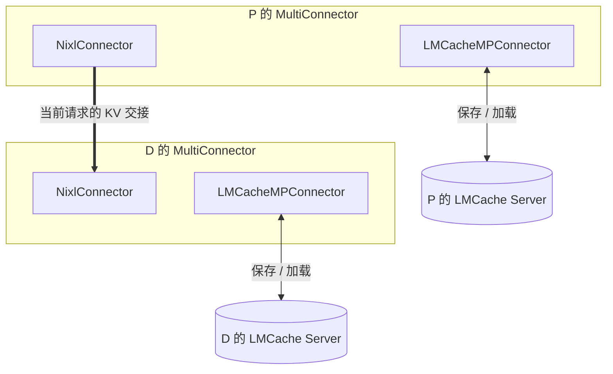
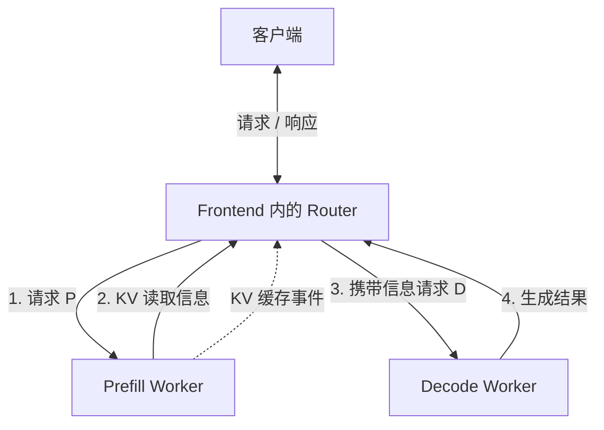
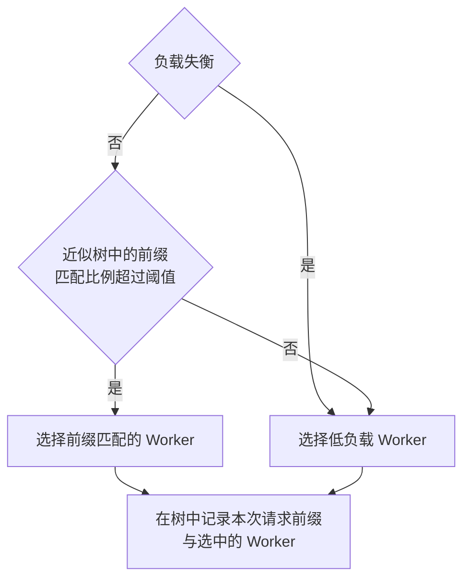

## 本章概要

分离式推理让多个 Worker 分工完成一次请求。Worker 指执行推理计算的服务实例，下面用 P、D 分别表示 Prefill 和 Decode 实例。拆分后需要解决的核心问题是：**计算结果传给谁、存在哪里、何时可以使用和释放**。

- **PD 分离**：在 Prefill 与 Decode 之间交接 KV Cache。
- **多模态 EPD 分离**：增加编码阶段，将图像编码得到的 embedding（特征向量）传给语言模型。
- **Attention–FFN 分离（AFD）**：把一层中的 Attention 和 FFN 分开执行，反复传递两部分计算所需的中间激活。

---

## PD 分离回顾

Prefill 与 Decode 的阶段特征、基本部署方式见 [06 - PD 分离](/talks/06-disaggregating-prefill-and-decoding)。

<Frame caption="原书图 17-1，图片获取自[中英对照 Markdown 仓库](https://github.com/notlate-cn/ai-systems-performance-engeering/tree/e3cd9597ffd7b8d7b236b4eca8b289e1affb7217/docs/assets/images/ch17)。">
  
</Frame>

独立的 Prefill Pool 与 Decode Pool 让两类计算分别排队，便于单独优化首 token 延迟（TTFT）和后续 token 的生成间隔（TPOT）。代价是增加 KV 传输和排队，也可能出现一侧繁忙、另一侧空闲。Chunked Prefill 通过拆小每次调度的 Prefill 工作量来减轻干扰，可以与 PD 分离组合使用。

<Frame caption="原书图 17-2，实验背景见 [DistServe](https://arxiv.org/abs/2401.09670)。图中的配置和数值对应特定模型、硬件与 SLO。">
  
</Frame>

比较部署方案时，需要固定总资源与请求分布，观察同时满足延迟约束的有效吞吐（goodput），并计入两个池的 GPU 成本。并行部署和 KV 通信预算见[第十五章：多节点大模型推理——并行部署、解码优化与 MoE 路由](/books/ai-systems-performance-engineering/chapters/ch15)。

---

## 分离式推理的组件分工

**一个项目可以覆盖多个层次，同一层也可以组合不同项目的组件。** [Dynamo](https://developer.nvidia.com/dynamo) 通过接入 vLLM、SGLang、TensorRT-LLM 等引擎执行模型，自身提供 Frontend、Router、Planner 和 KVBM 等组件，分别承担请求协调、容量调整和缓存管理。

<Frame caption="根据 [vLLM Connector 接口](https://github.com/vllm-project/vllm/blob/7a64fb8fc9239cb65e0df9313fa759594dfb206a/vllm/distributed/kv_transfer/kv_connector/v1/base.py)、[Dynamo KVBM](https://github.com/ai-dynamo/dynamo/blob/3032e8a703e5680d7481b9e499a6f979ed37bba1/lib/bindings/kvbm/README.md)及下表资料整理。横向色带表示职责分类，Dynamo 纵框内的组件也归入对应行；推理引擎为共用区域，具体组合受版本和引擎支持情况约束。">
  
</Frame>

**KV Connector 是引擎内的扩展接口，具体实现可以来自外部项目。** 例如，[DynamoConnector](https://github.com/ai-dynamo/dynamo/blob/3032e8a703e5680d7481b9e499a6f979ed37bba1/lib/bindings/kvbm/python/kvbm/vllm_integration/connector/dynamo_connector.py) 继承 vLLM 的 `KVConnectorBase_V1`，分别在 Scheduler 和 Worker 中运行，将 vLLM 接入 KVBM。图中将该插件列入 Dynamo 纵框，表示实现来源；它的运行位置仍在引擎内。

Dynamo v1.6.0 的[基础 PD 示例](https://github.com/ai-dynamo/dynamo/blob/701da25292ecca8f64d770cc0b17d389200019a1/examples/backends/vllm/launch/disagg.sh) 使用 vLLM 的 `NixlConnector` 交接 KV；[接入 KVBM 的示例](https://github.com/ai-dynamo/dynamo/blob/701da25292ecca8f64d770cc0b17d389200019a1/examples/backends/vllm/launch/disagg_kvbm.sh) 则在 P 侧通过 `PdConnector` 组合 `NixlConnector` 与 `DynamoConnector`，分别处理 P→D 传输和分层缓存。

缓存管理决定 KV 存在哪里、保留多久以及能否复用；传输库执行具体的内存读写。Dynamo、Mooncake 和 LMCache 都涉及这两类工作：

| 项目 | KV 保存与复用 | 数据怎么传 |
| --- | --- | --- |
| Dynamo | [KVBM](https://github.com/ai-dynamo/dynamo/blob/3032e8a703e5680d7481b9e499a6f979ed37bba1/lib/bindings/kvbm/README.md) 管理分层缓存，可按需接入 | KVBM 调用 NIXL；NIXL 是可独立使用的传输库，也能被 vLLM、LMCache 等项目调用 |
| Mooncake | [Mooncake Store](https://github.com/kvcache-ai/Mooncake/blob/6a835cbf934aa50c287261f255c83e6faffecb71/docs/source/design/architecture.md) 管理共享缓存池中的对象、副本和生命周期 | Store 调用 Mooncake Transfer Engine；Transfer Engine 也可单独用于 P、D 直接传输 |
| LMCache | 缓存服务管理本地缓存，并通过适配器接入外部存储，包括 [Mooncake Store](https://github.com/LMCache/LMCache/blob/6913259264dbebb2fa5ba1665606c40ffc5c6661/docs/source/mp/l2_storage/mooncake_store.rst) | MP 模式的 [P2P Transfer Channel](https://docs.lmcache.ai/mp/p2p.html#transfer-engine-backends) 可选择 NIXL 或 Mooncake Transfer Engine；访问 Store 则走对应的存储适配器 |

例如，`vLLM → LMCacheMPConnector → LMCache → Mooncake Store → Mooncake Transfer Engine` 是可配置的组合；若只需要 P、D 直接交接 KV，也可以通过引擎 Connector 调用传输库，省去共享缓存池。

---

## Connector 连接引擎与 KV 传输

**KV Connector（连接器）让推理引擎能够使用其他实例或外部缓存中的 KV。** 它向调度器报告可复用的 KV，将请求对应到具体的缓存块，调用传输库或缓存服务完成加载、保存，并报告完成或失败。调度器据此决定请求何时继续计算、哪些块可以释放。

例如，P 算完一个请求后，D 需要知道 KV 存在 P 的哪些块中、应放入自己的哪些块，以及数据何时可用。Connector 将这些信息与引擎的调度、内存管理衔接起来，底层的 NIXL 或 Mooncake Transfer Engine 则执行具体的数据搬运。

### vLLM 的 Connector 架构与执行流程

vLLM 的 Connector 分别运行在 Scheduler 进程和各个 GPU Worker 进程中：**调度侧衔接 KV 查询、块分配和请求状态，Worker 侧执行加载和保存。** 这里的 Scheduler 属于一个 vLLM 引擎；P、D 各有自己的 Scheduler。Dynamo Router 选择服务实例，实例内的 Scheduler 再决定哪些请求进入本轮计算、使用哪些 KV 块。

<Frame caption="来源：[vLLM — Disaggregated Prefilling](https://github.com/vllm-project/vllm/blob/7a64fb8fc9239cb65e0df9313fa759594dfb206a/docs/features/disagg_prefill.md#development)。图中的 `connector_metadata` 在本文采用的源码版本中对应 `kv_connector_metadata`。">
  
</Frame>

图中，从 Scheduler 指向 Worker 的细箭头随 `SchedulerOutput` 下发请求、块位置等传输信息；底部的双向粗箭头表示实际 KV 数据的传输。`Paged KV buffer` 是 Worker 持有的分页 KV 缓存，Worker 侧 Connector 将这些缓存块与底层传输库对接。

调度侧 Connector 通过 [KVConnectorBase_V1](https://github.com/vllm-project/vllm/blob/7a64fb8fc9239cb65e0df9313fa759594dfb206a/vllm/distributed/kv_transfer/kv_connector/v1/base.py) 向调度器报告外部有哪些 KV 可以复用。调度器分配本地 GPU 块后，Connector 再把块的位置和传输任务交给 Worker 执行。这里需要区分：**外部找到了 KV，不等于 KV 已经加载到本地、可以用于计算。**

<Frame caption="来源：[vLLM — Disaggregated Prefilling 的 Worker 时序图](https://github.com/vllm-project/vllm/blob/7a64fb8fc9239cb65e0df9313fa759594dfb206a/docs/features/disagg_prefill.md#development)。图中的 `wait_for_kv_layer` 对应本文源码版本的 `wait_for_layer_load`；图展示接口调用位置，具体 Connector 决定按层传输还是按请求传输。">
  
</Frame>

Worker 侧由 ModelRunner 调用 `start_load_kv` 启动加载。对于按层加载的实现，Attention 在使用该层 KV 前调用 `wait_for_layer_load` 等待就绪；计算出 KV 后，可以通过 `save_kv_layer` 提交保存。`wait_for_save` 负责提交保存任务并执行必要的同步，异步传输的最终完成结果再交回调度器。

调度器与 Worker 通过以下接口衔接一次传输：

| 接口 | 告诉调度器或 Worker 什么 | 接下来做什么 |
| --- | --- | --- |
| `get_num_new_matched_tokens` | 本地缓存之外，还能从外部获取多少 token 的 KV；是否需要异步加载 | 调度器决定哪些部分需要计算、哪些需要等待加载；返回 `None` 时稍后再查 |
| `update_state_after_alloc` | 本地已经分配了哪些块，需要加载多少 token 的 KV | Connector 确定数据写入位置；判断是否传输还要看外部 token 数 |
| `build_connector_meta` | 当前调度步要传输哪些请求的 KV，以及传输所需信息 | Worker 根据这些信息执行对应的传输任务 |
| `request_finished` | 请求结束后，是否还需要保留 KV 块供发送使用 | 发送未完成时，暂不释放源端的块 |
| `get_finished` | 哪些请求的 KV 已经发送或接收完成 | 让等待接收的请求继续执行，或释放发送完毕的块 |

例如，Prefill 已经算完一个请求，源 KV 仍可能被远端 Decode 读取。`request_finished` 可以要求延迟释放，直到完成通知到达。若在计算结束时立即把这些块分配给新请求，远端读取就可能遇到被覆盖的数据。

同样，Decode 分配接收块只代表已经留出了空间。KV 尚未传完时，Attention 还不能使用这些块；加载失败也需要通知调度器，避免使用不完整的数据。

<Note>
**算完了，不代表传完了；传输仍在进行时，相关内存不能提前分配给其他请求覆盖。** 发送端和接收端都要确认旧操作不再读写这些块，才能安全回收。
</Note>

### 不同 Connector 的 KV 路径

直接传输的 Connector 负责把当前请求从 P 交给 D；接入缓存服务的 Connector 还可以保存 KV，供后续请求复用。下表按本文采用的源码版本比较这些实现。

| vLLM Connector | KV 经过哪里 | 交接方式与用途 |
| --- | --- | --- |
| [NixlConnector / NixlPullConnector](https://github.com/vllm-project/vllm/blob/7a64fb8fc9239cb65e0df9313fa759594dfb206a/vllm/distributed/kv_transfer/kv_connector/v1/nixl/connector.py) | P 的 KV 内存 → D 的 KV 内存 | D 获得源端信息后发起 `READ`；P 保留源 KV，直到读取完成。该版本的 `NixlConnector` 是 Pull 实现的别名 |
| [NixlPushConnector](https://github.com/vllm-project/vllm/blob/7a64fb8fc9239cb65e0df9313fa759594dfb206a/docs/design/nixl_kv_push_connector.md) | P 的 KV 内存 → D 的 KV 内存 | D 提供已分配的目标块信息，P 发起 `WRITE`；接收端准备可以与 Prefill 计算重叠 |
| [MooncakeConnector](https://github.com/vllm-project/vllm/blob/7a64fb8fc9239cb65e0df9313fa759594dfb206a/vllm/distributed/kv_transfer/kv_connector/v1/mooncake/mooncake_connector.py) | P 的 KV 内存 → D 的 KV 内存 | D 请求 KV 并提供目标块信息，P 通过 Mooncake Transfer Engine 写入 D；用于引擎间直接交接 |
| [MooncakeStoreConnector](https://github.com/vllm-project/vllm/blob/7a64fb8fc9239cb65e0df9313fa759594dfb206a/vllm/distributed/kv_transfer/kv_connector/v1/mooncake/store/connector.py) | 引擎 ↔ Mooncake Store | 按对象查询、保存和加载 KV；共享存储中的副本可供后续请求使用 |
| [LMCacheMPConnector](https://github.com/vllm-project/vllm/blob/7a64fb8fc9239cb65e0df9313fa759594dfb206a/vllm/distributed/kv_transfer/kv_connector/v1/lmcache_mp_connector.py) | 引擎 ↔ 独立 LMCache Server | 查询可复用前缀，把 KV 保存到缓存服务或加载回 GPU；具体存储层级由 LMCache 配置决定 |
| [MultiConnector](https://github.com/vllm-project/vllm/blob/7a64fb8fc9239cb65e0df9313fa759594dfb206a/vllm/distributed/kv_transfer/kv_connector/v1/multi_connector.py) | 组合多个 Connector 的路径 | 例如用 NIXL 完成当前请求的 P→D 交接，同时用 LMCache 保存 KV，供后续请求复用 |

### NIXL Pull 与 Push

[NIXL](https://github.com/ai-dynamo/nixl) 负责注册可用于传输的内存，并在这些内存区域之间异步搬运数据。vLLM Connector 则找出请求所需 KV 对应的实际内存块，决定何时传输、何时通知调度器。即使底层使用 RDMA，Connector 仍需匹配两侧请求，并决定 KV 块何时可以释放。

[NIXL Pull 路径](https://github.com/vllm-project/vllm/blob/7a64fb8fc9239cb65e0df9313fa759594dfb206a/vllm/distributed/kv_transfer/kv_connector/v1/nixl/pull_worker.py) 由 Decode 根据 Prefill 提供的 KV 位置等信息发起 `READ`；[Push 路径](https://github.com/vllm-project/vllm/blob/7a64fb8fc9239cb65e0df9313fa759594dfb206a/vllm/distributed/kv_transfer/kv_connector/v1/nixl/push_worker.py) 由 Prefill 向 Decode 已注册的目标位置发起 `WRITE`。

<Frame caption="来源：[vLLM — Push-based KV Transfer with NIXL](https://vllm.ai/blog/2026-10-14-nixl-push-connector)。">
  
</Frame>

| 比较项 | Pull | Push |
| --- | --- | --- |
| 谁发起传输 | Decode 读取 Prefill KV | Prefill 写入 Decode KV |
| 开始传输前的准备 | D 拿到源端 KV 信息，并分配好接收块 | P 算出 KV，并拿到 D 的接收块注册信息 |
| D 的选择时机 | 可以在 P 返回交接信息后选择 | 为提前注册目标空间，需要更早确定 D |
| 等待期间占用的空间 | P 保留源 KV，等待 D 读取 | D 提前保留接收空间，等待 P 写入 |

- **早选 D**：目标分配和注册可以与 P 的工作重叠，D 的 KV 容量也会在真正开始生成之前就被占用。
- **晚选 D**：可以利用更新的负载信息，但接收端准备工作可能落在 Prefill 之后。

是否更快，取决于提前准备的工作能与计算重叠多少，以及等待期间占用了多少 KV 空间。

<Frame caption="来源同上；实现细节见 [NIXL Push Connector 设计](https://github.com/vllm-project/vllm/blob/7a64fb8fc9239cb65e0df9313fa759594dfb206a/docs/design/nixl_kv_push_connector.md)。">
  
</Frame>

D 注册好接收内存和 P 算完 KV，这两件事谁先完成都有可能。P 需要用请求 ID 找到对应的注册信息和计算结果，等两者都准备好，再由后台线程发送。超时回收内存时，还要确保旧请求的写入已经停止，避免它覆盖新请求的数据。

### Mooncake 的直接传输与共享存储

[Mooncake Transfer Engine](https://github.com/kvcache-ai/Mooncake/blob/6a835cbf934aa50c287261f255c83e6faffecb71/docs/source/design/architecture.md) 用 Segment 描述远端可访问的内存或存储区域，用 BatchTransfer 提交一组异步读写。两端先通过元数据服务或直接握手取得地址和连接信息，再直接传输数据；大块数据不经过元数据服务。

vLLM 中的 [MooncakeConnector](https://github.com/vllm-project/vllm/blob/7a64fb8fc9239cb65e0df9313fa759594dfb206a/vllm/distributed/kv_transfer/kv_connector/v1/mooncake/mooncake_connector.py) 使用 Transfer Engine 在两个引擎之间传输 KV。它先注册 KV 内存，再交换地址和排列方式，确定每个块需要从哪里读、写到哪里。两端还需核对层、KV 分组、块大小和偏移，因为相同 token 数对应的 KV，在两个实例中的内存排列可能不同。

[Mooncake Store Connector](https://github.com/vllm-project/vllm/blob/7a64fb8fc9239cb65e0df9313fa759594dfb206a/vllm/distributed/kv_transfer/kv_connector/v1/mooncake/store/connector.py) 则把 KV 接入共享存储。Store Master 记录 KV 对象存在哪里，管理空间分配、副本和租约；Client 通过 Transfer Engine 传输实际数据。直接传输用于两个引擎交接当前请求的 KV，共享存储则可以在请求结束后继续保存 KV，供后续请求复用。

<Frame caption="来源：[Mooncake Store 架构](https://github.com/kvcache-ai/Mooncake/blob/6a835cbf934aa50c287261f255c83e6faffecb71/docs/source/design/store/mooncake-store.md#architecture)。图中展示 Client 嵌入 vLLM 进程、也可独立提供存储的部署方式。">
  
</Frame>

图中紫色连线传递对象位置、空间分配等信息，底部黑色连线通过 Transfer Engine 搬运 KV。绿色横条表示各节点共同提供的逻辑内存池，实际数据仍分散保存在各节点的内存中。

vLLM 的 `MultiConnector` 可以组合 PD Connector 与 Store Connector，同时支持当前请求的 P→D 交接和后续请求的 KV 复用。

<Frame caption="来源：[Serving Agentic Workloads at Scale with vLLM x Mooncake](https://vllm.ai/blog/2026-05-06-mooncake-store)，图 3（2026-05-06）。动画展示 MultiConnector 将 PD 分离与分布式 KV 缓存池结合。">
  
</Frame>

在该博客描述的实现中，P 从共享池加载命中的前缀，再通过 PD Connector 把 KV 传给 D；P、D 都可以将 KV 保存到池中，供后续请求复用。**D 当时尚不直接从共享池加载 KV**，它所需的历史 KV 由 P 交接。

### LMCache 的独立缓存服务

LMCache 的 MP（多进程）模式将缓存服务放在独立进程中。vLLM 通过 `LMCacheMPConnector` 接入服务，使用 ZMQ RPC 提交保存、查询和加载请求；同机的多个 vLLM 实例可以共享这个服务及其 CPU 内存池。

<Frame caption="来源：[When Open Source Meets Open Source: A Joint Effort Between LMCache and Mooncake](https://blog.lmcache.ai/en/2026/05/26/when-open-source-meets-open-source-a-joint-effort-between-lmcache-and-mooncake/)（LMCache 官方博客，2026-05-26）。图中 L1 是 CPU 共享内存池，L2 是通过适配器接入的外部存储。">
  
</Frame>

LMCache Server 内部的三个组件分工如下：

| 组件 | 作用 |
| --- | --- |
| **L1 Manager** | 管理 CPU 共享内存池，保存 KV，供引擎存取 |
| **StoreController** | 将 KV 从 **L1 → L2** 异步保存 |
| **PrefetchController** | 查询命中 L2 后，将 KV 从 **L2 → L1** 异步预取，供引擎随后加载 |

接入 Mooncake Store 时，两个 Controller 通过 `mooncake_store adapter` 访问它。**L2 → L1 的预取占用 CPU 内存；执行模型前，仍需将 KV 加载到引擎分配的 GPU KV 块中。**

图中的 `mooncake_store adapter` 位于 LMCache 内部，负责接入 Mooncake Store；引擎侧的 `LMCacheMPConnector` 负责衔接 vLLM 的调度与加载、保存操作。两者串联后，Mooncake Store 就成为 LMCache 可使用的外部缓存后端。

### vLLM Worker 与 LMCache 的 KV 搬运

Worker 与 LMCache Server 运行在不同进程中。保存 KV 时，需要将引擎中分散的分页块收集到缓存缓冲区，这一步称为 **gather**；恢复时，将缓存中的 KV 写回引擎分配的分页块，称为 **scatter**。

<Frame caption="来源：[Understanding LMCache MP Mode Transfer Paths: A Beginner’s Guide](https://blog.lmcache.ai/en/2026/06/15/understanding-lmcache-mp-mode-transfer-paths-a-beginners-guide/)（LMCache 官方博客，2026-06-15）。三条彩色路径展示 Worker → CPU L1 的保存过程，恢复时反向搬运。">
  
</Frame>

| 搬运方式 | 执行方 | 保存时的数据路线 | 原文中的复制次数 |
| --- | --- | --- | --- |
| CUDA IPC（橙色） | LMCache Server | Worker GPU 分页块 → GPU 临时连续缓冲区 → CPU L1 | 2 次：GPU 内 gather，再复制到 CPU |
| SHM（绿色，非 CUDA 路径） | vLLM Worker | Worker KV → 双方映射的同一块 CPU L1 | 1 次；使用 Python fallback 时为 2 次 |
| pickle（紫色，非 CUDA 回退路径） | Worker 打包，Server 接收并写入 | Worker KV → CPU 缓冲区 → 序列化，经 ZMQ 发送 → 反序列化 → L1 | 4 次：收集、序列化、反序列化、写入 |

CUDA IPC 让 Server 获得访问 Worker GPU 内存的句柄，保存到 CPU L1 仍需复制。SHM 让两个进程共享 L1，Worker 写入后 Server 即可使用；图中的 1 次复制要求使用设备专用 C 算子，Python fallback 会增加临时缓冲区。上述次数按原文实现统计，不包含对底层通信栈所有复制操作的逐项计数。

**ZMQ 传递保存、加载等控制请求；pickle 路径还通过它发送 KV 字节。** 这些路径连接 Worker 与 L1；L1 与 Mooncake Store 等 L2 后端之间的保存和预取，则由 StoreController、PrefetchController 和存储适配器完成。

### KV 的三种部署路径

KV 可以在引擎间直接交接，也可以通过外部缓存保存和复用：

- **P → D 直接传输**：通过 `NixlConnector` 或 `MooncakeConnector`，把当前请求的 KV 从 P 交接给 D。
- **vLLM → Mooncake Store**：通过 `MooncakeStoreConnector` 直接接入共享缓存池，保存和加载可复用的 KV。
- **vLLM → LMCache → Mooncake Store**：通过 `LMCacheMPConnector` 接入 LMCache，再由 `mooncake_store adapter` 访问 Store。LMCache 管理 L1 内存池及 L1/L2 之间的保存与预取，Mooncake Store 提供共享存储。

L1 Manager、StoreController 和 PrefetchController 共同负责第三种部署中 LMCache 内部的缓存管理。P→D 直接传输与外部缓存还可以通过 `MultiConnector` 组合使用。

### LMCache 与 MultiConnector

[LMCache 的 MP 分离式 Prefill 示例](https://github.com/LMCache/LMCache/blob/6913259264dbebb2fa5ba1665606c40ffc5c6661/docs/source/mp/disaggregated_prefill.rst) 使用 `MultiConnector` 组合两条路径：`NixlConnector` 负责本次请求的 P→D KV 交接，`LMCacheMPConnector` 负责引擎与独立 LMCache Server 之间的保存、查询和恢复。

<Frame caption="根据上述 LMCache MP 示例整理；图中只画 KV 数据路径，省略请求路由与握手。两侧的 LMCache Server 分别保存各自引擎的 KV。">

</Frame>

Prefill 侧按本地 GPU Cache、LMCache、重新计算的顺序获取 KV。一次请求结束后，保存到 LMCache 的前缀仍可服务后续请求，即使引擎 HBM 中的副本已经被淘汰。该示例为 P、D 分别部署 LMCache Server；跨服务器复用需要另行配置 P2P 与协调服务。

这两个 Connector 分别完成两件事：**把 KV 传给当前请求的 D，以及保存 KV 供后续请求复用。** 它们可以使用相同的传输库，但需要分别决定数据保留多久、何时释放，以及失败后怎么处理。当前 MP 示例还依赖 vLLM 的 MultiConnector 实际块传递修复，部署版本应按示例要求核对，不能直接沿用早期 in-process LMCache 的配置。

---

## KV 的保存、复用与释放

### 引擎内缓存与外部缓存

<Frame caption="原书图 17-5。KV 可以保存在 GPU、CPU 或 SSD 中，具体使用哪些层级取决于部署。">
  
</Frame>

引擎本地 Prefix Cache 保留已计算的前缀 KV。新请求具有相同前缀时，可以直接使用显存（HBM）中的这些块。外部缓存能保存更多 KV，但再次使用前需要查找、加载，有时还要转换数据排列方式。因此，本地命中和外部命中节省的时间并不相同。

| 缓存方案 | KV 存在哪里、由谁管理 | 请求结束后如何保留 | 再次使用前需要做什么 |
| --- | --- | --- | --- |
| 引擎本地 Prefix Cache | 当前引擎的显存，由块管理器管理 | 可复用的块继续留在本地，空间不足时可能淘汰 | 查找匹配前缀，直接复用已有块 |
| Mooncake Store | 集群提供的共享内存或存储，Master 记录对象位置 | 按租约、副本和淘汰策略保留对象 | 查询可用副本，将 KV 加载到引擎分配的块中 |
| LMCache MP | 独立的 LMCache Server 及配置的存储后端 | 已保存的 KV 可以供后续请求复用 | 向缓存服务查询并加载 KV；跨服务器复用需配置共享 |

Mooncake Store 的 Master 告诉 Client 到哪里取 KV，Client 直接访问保存数据的节点。LMCache MP 则由独立缓存服务配合 Connector 完成查询、保存和加载。排查两类系统时，都需要分开确认两件事：缓存服务里是否还保存着这份 KV，以及引擎是否已经把它加载到本地。

### P 少算多少与 D 少传多少

**P、D 各有自己的本地 KV Cache。P 命中前缀可以减少 Prefill 计算；D 命中前缀可以减少需要接收的 KV。**

假设请求包含 10,000 个 prompt token，P 已缓存前 8,000 个 token 的 KV，只需计算后 2,000 个。对于全注意力模型，D 在继续生成时仍需要完整的历史 KV，但其中有多少需要从 P 接收，取决于 D 自己已经缓存了多少：

| 情况 | P 已缓存的前缀 | D 已缓存的前缀 | P 需要新计算 | D 需要从 P 接收的 KV |
| --- | --- | --- | --- | --- |
| 只有 P 命中 | 8,000 token | 0 token | 2,000 token | 10,000 token 对应的 KV |
| P、D 都命中相同前缀 | 8,000 token | 8,000 token | 2,000 token | 2,000 token 对应的 KV |

第一种情况下，P 将**已有的 8,000 token KV 和新算出的 2,000 token KV** 一起传给 D。P 省下了重复计算，但 D 的本地缓存为空，仍需接收完整的 prompt KV。第二种情况下，D 可以复用自己的前 8,000 token KV，只接收缺少的后 2,000 token KV。

第二种情况要求 Connector 能识别并跳过 D 已有的前缀。例如，[vLLM NIXL Pull Scheduler](https://github.com/vllm-project/vllm/blob/7a64fb8fc9239cb65e0df9313fa759594dfb206a/vllm/distributed/kv_transfer/kv_connector/v1/nixl/pull_scheduler.py) 会从远端可提供的 token 数中扣除 D 本地已可复用的 token 数，确定还需加载的范围。表中按 token 数说明差别，省略了缓存块对齐和边界 token 的处理。

### KV 块的保留与释放

在上述 NIXL Pull 实现中，如果 P 已为交接保留了 KV，而 D 的本地缓存恰好全部命中，D 仍需通知 P：本次交接已经结束，可以解除对这些块的保留。解除传输占用后，这些 KV 是否继续作为 Prefix Cache 保留，由 P 的本地缓存策略决定。

请求取消时，P 可能仍在发送 KV，D 已经分配了接收空间，外部存储也可能通过租约暂时保留着副本。这些内存不能一起立即释放。尤其是通信超时，只代表等待时间超限，不代表读写已经停止；回收内存前必须确认旧操作不会再访问它。

“缓存中没找到”和“传输到一半失败”也要分开处理。前者通常可以转为计算缺失部分；后者要按后端的错误处理策略执行。LMCache MP 示例将 NIXL 加载失败设为 `fail`，而它的 L2 缓存适配器目前不区分加载失败与缓存未命中。能否在 D 上重新计算，还取决于 D 是否支持 Prefill，以及当前请求是否允许改走这条路径。

---

## Worker 选择与请求转发

### llm-d 先选 D，再决定是否使用远端 P

llm-d 在 Kubernetes 中组织 vLLM 实例，将请求路由、P/D 之间的 KV 交接、共享前缀缓存和副本扩缩容连接起来。原书图 15-4 展示了这些组件的关系。

<Frame caption="原书图 15-4：基于 Kubernetes 的 llm-d / vLLM 分离式推理架构。图片来自[中英对照 Markdown 仓库](https://github.com/notlate-cn/ai-systems-performance-engeering/blob/e3cd9597ffd7b8d7b236b4eca8b289e1affb7217/docs/assets/images/ch15/fig15_995_1.png)，对应[原书第十五章的说明](https://github.com/notlate-cn/ai-systems-performance-engeering/blob/e3cd9597ffd7b8d7b236b4eca8b289e1affb7217/docs/chapters/ch15.md)。图中的缓存后端是架构示例。">
  
</Frame>

图中 P、D 之间经过 NIXL 的连线，以及两侧通向共享缓存的连线，对应前面介绍的两类 Connector 路径：**交接当前请求的 KV，以及保存、加载可复用的 KV。** 右侧的 Inference Scheduler 根据负载与缓存情况选择实例，Variant Autoscaler 则调整实例数量。

[llm-d 的分离式服务设计](https://github.com/llm-d/llm-d/blob/d5e53624ca354290b48323a3786b4a9bba836e0b/docs/architecture/disaggregation/pd-disaggregation.md) 由 Endpoint Picker（EPP）选择实例，再由 D Pod 中的 Routing Sidecar（请求代理）分别向 P 和 D 发起请求。

<Accordion title="llm-d 官方请求转发图">

<Frame caption="来源：[llm-d PD Disaggregation 架构图](https://github.com/llm-d/llm-d/blob/d5e53624ca354290b48323a3786b4a9bba836e0b/docs/assets/pd-disaggregation.svg)。">
  
</Frame>

</Accordion>

`disagg-profile-handler` 按以下顺序选择实例：

1. **选择 D**：运行 Decode profile，确定目标 Decode 实例。
2. **判断是否分离**：decider 根据已选 D 上未缓存的 prompt 部分，决定是否选择远端 P。
3. **按需选择 P**：需要分离时运行 Prefill profile，将 P、D 地址一起交给代理。

这个顺序让“是否远程 Prefill”可以利用已选 D 的缓存信息；省略 P 的路径要求目标实例具备相应执行能力。

在 vLLM/NIXL 路径中，Sidecar 先请求 P，获得 `KVTransferParams` 后再调用 D，由 D 拉取 KV。SGLang 的交接路径则使用 bootstrap 信息协调 P、D，可并发发起两侧请求。Sidecar 的控制顺序要适配引擎协议，不能只把后端名称替换掉。

### Dynamo + vLLM 的路由与交接

截至 2026-10-25，Dynamo v1.6.0 与主分支的[基础 vLLM PD 示例](https://github.com/ai-dynamo/dynamo/blob/701da25292ecca8f64d770cc0b17d389200019a1/examples/backends/vllm/launch/disagg.sh) 使用集成 Frontend 和 `NixlConnector`。在未启用条件式分离时，[PrefillRouter](https://github.com/ai-dynamo/dynamo/blob/701da25292ecca8f64d770cc0b17d389200019a1/lib/llm/src/kv_router/prefill_router/mod.rs) 先选择并请求 P，收到 Prefill 的交接信息后，再把请求送入 D 的路由阶段。

P 侧的 [vLLM Handler](https://github.com/ai-dynamo/dynamo/blob/701da25292ecca8f64d770cc0b17d389200019a1/components/src/dynamo/vllm/handlers.py) 将生成长度设为 1，返回 `disaggregated_params`，其中的 `kv_transfer_params` 包含源端块和连接信息。Frontend 将这些信息放入 D 请求的 `prefill_result`；D 侧 Handler 再把传输参数交给 vLLM 引擎。

<Frame caption="译自 [Dynamo 分离式路由文档](https://github.com/ai-dynamo/dynamo/blob/701da25292ecca8f64d770cc0b17d389200019a1/docs/fern/pages/developer-guide/knowledge-base/modular-components/router/disaggregated-serving.md)的请求流程图，对应未启用条件式分离的 vLLM 路径。实线表示请求与响应，虚线表示缓存事件；实际 KV 在 P、D 之间传输。">

</Frame>

D 内部的 [vLLM Scheduler](https://github.com/vllm-project/vllm/blob/e4a5b5537344b103ed10de7764378ef09604ef3d/vllm/v1/core/sched/scheduler.py) 结合本地缓存和 Connector 报告的外部 KV 数量分配接收块，并把需要异步加载的请求置为 `WAITING_FOR_REMOTE_KVS`。Worker 侧的 [NIXL Pull 实现](https://github.com/vllm-project/vllm/blob/e4a5b5537344b103ed10de7764378ef09604ef3d/vllm/distributed/kv_transfer/kv_connector/v1/nixl/pull_worker.py) 发起 `READ`，从 P 读取 KV；加载完成后，Scheduler 才让请求恢复执行。**Dynamo 决定请求交给哪个实例，vLLM Scheduler 管理实例内的计算与块分配，Connector 执行两者约定的 KV 交接。**

未启用条件式分离时，[D 路由的配置](https://github.com/ai-dynamo/dynamo/blob/701da25292ecca8f64d770cc0b17d389200019a1/lib/llm/src/kv_router/prefill_router/mod.rs#L746) 将 `overlap_score_credit` 设为 0，也就是不因 D 的前缀匹配程度给它加分。D 引擎仍可检查自己的本地前缀缓存；路由评分与引擎实际复用是两个步骤。如果 P、D 分布在不同机架或区域，还可以根据已选 P 的位置限制 D 的候选范围。

在这条 Frontend 路径中，P 请求或交接信息处理失败会返回错误，不会因此自动切换为 D 本地 Prefill。D 引擎内部的 KV 加载失败则由 [vLLM 的 `kv_load_failure_policy`](https://github.com/vllm-project/vllm/blob/e4a5b5537344b103ed10de7764378ef09604ef3d/vllm/v1/core/sched/scheduler.py#L184) 等配置决定，可以选择重算或失败返回；实际可用的恢复方式还取决于 Connector 和引擎配置。

<Accordion title="原书对照：2025 年 Decode-centric 交接">

[GTC 2025 Dynamo Tutorial（S73042）](https://www.nvidia.com/en-us/on-demand/session/gtc25-s73042/) 第 32 页及原书介绍的是早期 **Decode-centric（以 Decode 为中心）** 路径：请求先交给 D，由 D 决定是否把 Prefill 交给远端 P。D 提前分配接收 KV 的空间，P 完成后写回这些位置。这条路径中的 P、D 都使用 vLLM；教程第 38–39 页配置的是当时的 `DynamoNixlConnector`。

<Frame caption="来源：[NVIDIA Dynamo 官方介绍](https://developer.nvidia.com/blog/introducing-nvidia-dynamo-a-low-latency-distributed-inference-framework-for-scaling-reasoning-ai-models/)，2025 年 3 月，图 3。此图展示组件关系，Decode-centric 的请求顺序见后面的时序图。">
  
</Frame>

图中的 Prefill Engine 和 Decode Engine 可以由 vLLM 执行，内部仍保留调度器、KV 块管理和 Connector。Dynamo 在这些引擎之间协调请求，NIXL 连接实际数据路径。Smart Router 维护用于选实例的缓存位置索引；右侧 KV Cache Manager 则负责可选的缓存卸载，二者分别处理路由信息和 KV 副本。

<Frame caption="原书图 17-3，来源：[中英对照 Markdown 仓库](https://github.com/notlate-cn/ai-systems-performance-engeering/blob/e3cd9597ffd7b8d7b236b4eca8b289e1affb7217/docs/chapters/ch17.md)。图中的队列传递 Prefill 任务和块信息，KV 数据在 P、D 之间直接传输。">
  
</Frame>

1. **D 接收请求并分配空间**：检查本地前缀缓存，结合待计算的 Prefill 长度和排队情况决定是否使用远端 P；需要远端计算时，准备接收 KV 的块。
2. **P 领取 Prefill 任务**：任务携带请求和 D 的目标块信息。原书图中还包含一条可选路径：P 读取 D 已缓存的前缀，减少重复计算。
3. **P 计算并传回 KV**：P 完成缺失部分的 Prefill，通过 NIXL 将 KV 写入 D 已分配的块，然后发送完成通知。
4. **D 开始生成**：接收完成后，把该请求加入 Decode 调度；等待 KV 期间，D 可以继续处理其他请求。

这个流程中，D 服务协调远端 Prefill，其内部的 vLLM 调度器和块管理器仍参与请求执行与内存分配。Connector 将块信息落实为传输，并把完成结果交回引擎。**Decode-centric 描述实例之间的请求顺序，Scheduler 描述单个引擎内部的调度，Pull / Push 描述 KV 数据由谁发起读写。** 原书这条路径先选 D，再由 P 写入。

<Note>
这幅时序图对应 2025 年的实现。Dynamo v1.6.0 的集成 Frontend 基础示例采用先 P 后 D 的顺序；是否使用远端 P，也可以由 Router 的条件式分离策略决定。早期的 `DynamoNixlConnector`、当前用于 PD 的 `NixlConnector` 和接入 KVBM 的 `DynamoConnector` 属于不同实现。
</Note>

</Accordion>

### Dynamo 的条件式分离

[Conditional Disaggregation](https://github.com/ai-dynamo/dynamo/blob/701da25292ecca8f64d770cc0b17d389200019a1/docs/fern/pages/developer-guide/advanced-customizations/conditional-disaggregation.md) 在 v1.6.0 中属于默认关闭的实验功能。开启 `--router-conditional-disagg` 后，Router 可以在派发到 P 之前，选择让某个 D 本地执行 Prefill 和 Decode。该功能要求 KV-aware 路由及 D 的缓存事件；vLLM 的 P、D 都需配置事件发布。

Router 用 prompt 长度减去候选 D 的缓存前缀，估计仍需计算的 token 数，再按配置的策略比较其数量、占 prompt 的比例或 P 的负载。还可以配置 D 的负载上限，避免将额外 Prefill 压到繁忙的 D 上。选择本地执行时，Router 添加 `x-bypass-remote-prefill` 标记，[D 侧 Handler](https://github.com/ai-dynamo/dynamo/blob/701da25292ecca8f64d770cc0b17d389200019a1/components/src/dynamo/vllm/handlers.py#L3899) 据此按聚合模式处理该请求；计算仍由本地 vLLM Scheduler 安排。

开启该策略后，D 的路由按配置使用缓存匹配评分，不再被普通分离路径强制设为 0。这是一项在远端 Prefill 开始前做出的路由选择，与 P 执行失败后的重试不同；2025 年教程则由先收到请求的 D 服务决定是否调用远端 P。

### 两种路由路径的对比

| 比较项 | Dynamo 集成 Prefill-first 路径 | llm-d 分离 profile |
| --- | --- | --- |
| Worker 选择顺序 | P 后 D | 先 D，再决定是否选 P |
| 谁向 P、D 转发请求 | Frontend 与内部路由组件 | D Pod 的 Routing Sidecar |
| 选择实例时考虑哪侧缓存 | 主要考虑 P；该模式不按 D 的前缀匹配程度评分 | decider 根据已选 D 缺少多少 KV，判断是否需要远端 P |
| 需要注意的限制 | 请求发给 P 后，失败不会自动转为 D 本地 Prefill | Sidecar 向两侧发请求的顺序取决于引擎的传输协议 |

---

## 结合缓存与负载选择 Worker

### Dynamo 根据 vLLM 事件记录缓存位置

[Dynamo Router](https://github.com/ai-dynamo/dynamo/blob/3032e8a703e5680d7481b9e499a6f979ed37bba1/docs/fern/pages/developer-guide/knowledge-base/modular-components/router/router-design.md) 根据引擎发布的 KV stored/removed（保存/移除）事件，记录哪些前缀存在哪些 Worker 或缓存层。实际 KV 由 vLLM 等组件保存，Router 保存的是位置记录。选择 Worker 时，Router 同时考虑能复用多少前缀，以及该 Worker 当前有多忙。

在 **Dynamo Router + vLLM 本地 Prefix Cache** 的组合中，两侧分别执行缓存管理和路由策略：

| 决策 | 负责组件 | 依据 |
| --- | --- | --- |
| 本地 GPU KV 块怎样分配、复用和淘汰 | vLLM 的 KV Cache Manager / [BlockPool](https://github.com/vllm-project/vllm/blob/7a64fb8fc9239cb65e0df9313fa759594dfb206a/vllm/v1/core/block_pool.py) | 引擎的缓存配置、块引用和可用空间 |
| 某个前缀目前记录在哪些实例上 | Dynamo KV Indexer | Worker 上报的保存、移除事件 |
| 新请求发给哪个实例 | Dynamo Router | 缓存复用收益、当前负载及路由权重 |

例如，vLLM 为新请求回收了一个旧前缀的缓存块，会发布 `BlockRemoved` 事件；Dynamo 收到后更新对应的位置记录。即使事件尚未到达，实际执行时仍由 vLLM 检查缓存是否可用。提高 Router 对缓存命中的权重，会改变实例选择；本地块的保留与淘汰仍按引擎策略执行。

如果再接入 [Dynamo KVBM](https://docs.nvidia.com/dynamo/v-0-8-0/components/kvbm/kvbm-in-v-llm)、LMCache 或 Mooncake Store，外部副本还受对应缓存组件的保留与淘汰策略控制。例如，GPU 中的副本已经淘汰，CPU 或存储中的副本仍可能存在；引擎需要通过 Connector 加载后才能使用。

<Frame caption="来源：[Dynamo — Routing Concepts](https://github.com/ai-dynamo/dynamo/blob/3032e8a703e5680d7481b9e499a6f979ed37bba1/docs/fern/pages/developer-guide/knowledge-base/modular-components/router/routing-concepts.md#cost-calculation)。KV Indexer 提供前缀匹配信息，Slot Tracker 跟踪正在处理的请求负载。">
  
</Frame>

图的上半部分是新请求的评分路径，下半部分是 Worker 更新缓存位置记录的路径。缓存命中会减少预计需要计算的 Prefill 工作量，已有请求的负载则会增加该 Worker 的预计成本。

对两个候选 P，缓存更多的一侧未必更早完成。某个 Worker 若少算 4,000 个 token，却需要额外排队 300 ms，而另一个空闲 Worker 只需 100 ms 完成这些计算，最长前缀匹配就不是更好的选择。这些时间只是示例，实际选择需要使用对应模型和硬件上的测量结果。

事件传到 Router 需要时间，多个 Router 看到的负载也可能不同。即使 Router 记录某份 KV 仍在，实际执行请求时它也可能已被淘汰，因此还需要引擎确认能否复用。Dynamo 也支持近似模式，并非所有部署都使用 KV 事件。

### SGLang Router 根据请求历史估计缓存位置

Radix Tree（基数树）把相同前缀放在同一条路径上，不同后缀在分叉处展开。引擎可以用它查找已有 KV，Router 也可以用它记录请求曾发给哪个 Worker。两者使用相似的数据结构，但后者只能推测 KV 是否还在。

[SGLang Gateway 的 `CacheAwarePolicy`](https://github.com/sgl-project/sglang/blob/406786fd910dd82d03d1ce2c2e4c08b547786bc2/sgl-model-gateway/src/policies/cache_aware.rs) 记录请求文本及其被分配到的 Worker。后续请求出现相同前缀时，就据此估计哪个 Worker 可能有缓存。这省去了每次向 Worker 查询完整缓存的开销，但旧 KV 可能已经被淘汰。

该实现先判断负载是否明显失衡：绝对负载差和相对比例同时越过阈值时，优先选择低负载实例；负载较平衡时，使用前缀匹配和阈值选择实例，匹配不足时转向最小负载。具体行为以链接中的策略实现为准，不把它推广到 SGLang 的所有路由模式。

<Frame caption="根据上述 CacheAwarePolicy 源码整理的正常选择流程，假定候选 Worker 健康且近似树已建立。树中记录的是请求前缀与 Worker 的对应关系。">

</Frame>

| 比较项 | Dynamo 的 KV 事件模式 | SGLang `CacheAwarePolicy` |
| --- | --- | --- |
| 缓存位置从哪里得知 | 引擎或缓存层报告 KV 的保存与移除 | Router 记录请求曾被发给哪个 Worker |
| 需要额外做的工作 | 发送和接收事件，更新缓存位置记录 | 保存请求前缀及对应 Worker 的记录 |
| 记录可能不准的原因 | 事件延迟、丢失或记录正在重建 | 请求虽然发到过该 Worker，但 KV 可能已被淘汰 |
| 缓存多但 Worker 很忙时 | 将缓存复用收益与当前负载一起评分 | 负载明显失衡时先选低负载实例，否则考虑前缀匹配 |

以 vLLM 为主的系统可以使用 Dynamo 的事件路由。SGLang 的这个策略提供了另一种选择：通过请求历史估计缓存位置。比较两者时，需要看维护这些记录的开销，以及记录不准确时对路由的影响。

---

## Prefill 与 Decode 的扩缩容和过载处理

### Dynamo Planner 预测需求并根据负载调整实例数

<Frame caption="原书图 17-7，用于说明双池容量随输入、输出需求变化；当前控制流程见 [Dynamo Planner Design](https://github.com/ai-dynamo/dynamo/blob/3032e8a703e5680d7481b9e499a6f979ed37bba1/docs/fern/pages/developer-guide/knowledge-base/modular-components/planner/planner-design.md)。">
  
</Frame>

Dynamo Planner 将提前准备容量和响应当前负载分开处理：

- **Throughput-based 预测**：使用流量、输入输出长度及性能模型估计容量需求，调整周期较慢。
- **Load-based 修正**：根据实际前向计算耗时、排队情况和 Worker 状态，更快地调整实例数。

两者同时启用时，预测结果确定**至少保留多少个实例**。实时负载增加时可以继续扩容，但不会因为短暂空闲就缩到这个数量以下，以免过早撤掉为后续流量准备的实例。

判断应该扩哪一侧，需要看不同指标。P 主要看还有多少未命中输入 token 等待计算；D 要看同时生成的请求数、上下文长度、KV 显存占用和每轮生成耗时。仅看 GPU 利用率，很难判断瓶颈在哪。

在固定长度分布下，可以把各阶段能力折算为请求速率，得到容量上界：

$$
R_{system} \leq \min(R_P, R_D, R_{handoff})
$$

其中 $R_P$、$R_D$、$R_{handoff}$ 分别表示 P、D 和 KV 传输能支持的请求速率。实际 goodput 还会受到排队、尾延迟，以及各实例空闲资源能否被利用的影响。

如果 D 或网络已经饱和，继续扩 P 只会让更多请求算完后等待。新实例还需要加载权重和预热，因此突发流量也不能完全靠即时扩容解决。

### Mooncake 提前拒绝预计无法按时完成的请求

[Mooncake 论文](https://arxiv.org/abs/2407.00079) 从资源受限下的过载出发：如果请求完成 Prefill 后没有满足延迟目标的 Decode 容量，已经投入的 Prefill 计算和 KV 传输可能无法产生有效结果。其 early rejection 策略尝试在投入这部分资源前，预测请求进入 Decode 时的负载并决定是否接纳。

如果只看 D 现在是否繁忙，容易出现反复波动：D 忙时大量拒绝新请求，等现有请求完成后，又可能没有足够的新请求进入 D；此时集中接收请求，经过一段 Prefill 时间，D 又会变忙。论文因此估计请求完成 Prefill 后的负载，再决定是否接收。Planner 调整实例数量，early rejection 则在容量暂时不变时决定接收哪些请求。

当前开源 [Mooncake Conductor](https://github.com/kvcache-ai/Mooncake/blob/6a835cbf934aa50c287261f255c83e6faffecb71/docs/source/design/architecture.md) 提供全局前缀索引和查询服务；不能把论文中完整的调度与拒绝策略视为安装 Transfer Engine 或 Store 后自动获得的行为。

| 比较项 | Dynamo Planner | Mooncake 论文的 early rejection |
| --- | --- | --- |
| 采取的动作 | 增减 P、D 实例数 | 决定是否接收当前请求 |
| 需要的条件 | 有空闲硬件，且新实例能完成加载与预热 | 能估计请求完成 Prefill 后，D 是否还有足够处理能力 |
| 解决的问题 | 持续需求变化与两池容量失衡 | 容量暂时不足时减少无效计算 |

---

## 多模态 EPD 分离

EPD 在多模态推理中进一步拆出 Encode（编码）阶段，让视觉编码与语言模型的 Prefill、Decode 分开调度。独立的编码池可以按图像负载调整批量和容量，减少视觉编码对语言模型计算的干扰；在文本与图像混合流量中，纯文本请求也能减少等待图像编码造成的阻塞。编码占比较高时，这有助于改善 TTFT 和满足延迟约束的 goodput。

代价是增加 embedding 传输、跨 Worker 协调和排队。独立编码 Worker 如果与语言模型共享 GPU，仍会竞争算力；如果独占 GPU，则可能因图像请求不足而闲置。E、P、D 的容量也需要匹配：P 或 D 已经繁忙时，继续增加 E 可能扩大下游队列。[NVIDIA 的 EPD 分析](https://developer.nvidia.com/blog/when-to-use-encode-prefill-decode-disaggregation-to-accelerate-multimodal-model-serving/)比较了这些部署方式和负载条件。

### 编码 Worker 的放置方式

下图从左到右分别是聚合执行、Worker 分开但共享 GPU，以及编码池使用独立 GPU。中间方案分开队列与批处理；右侧方案进一步隔离硬件资源，并通过 NIXL 传递 embedding。图中的 P、D 仍共置，拆出 E 可以独立于 PD 分离实施。

<Frame caption="来源：[NVIDIA — When to Use Encode-Prefill-Decode Disaggregation](https://developer.nvidia.com/blog/when-to-use-encode-prefill-decode-disaggregation-to-accelerate-multimodal-model-serving/)，图 3。右侧方案额外使用编码 GPU，需要计入总资源与成本。">
  
</Frame>

### 编码池与 Embedding 交接

[Dynamo 的 Encoder Disaggregation](https://docs.nvidia.com/dynamo/v1.2.1/user-guides/multimodal/encoder-disaggregation) 将视觉编码从语言模型执行路径移到独立 Encode Worker。E 计算图像 embedding，再交给下游语言模型；P 完成 prompt 计算并把 KV 交给 D。E 传的是图像特征，P 传的是语言模型的 KV，分别供后续不同的计算使用。

<Frame caption="来源：[NVIDIA Dynamo — EPD Disaggregation for Multimodal Inference](https://docs.nvidia.com/dynamo/dev/digest/epd-disaggregation-multimodal)。图中的 embedding 缓存与请求关系对应该文描述的路径。">
  
</Frame>

| 部署方式 | 各阶段运行在哪些 Worker 上 | Worker 之间传什么数据 |
| --- | --- | --- |
| E/PD | 独立 E；P 与 D 共置 | E→PD 的 embedding |
| E/P/D | E、P、D 分别独立 | E→P 的 embedding；P→D 的 KV |

### Embedding 与 KV 的复用范围

Embedding Cache 与 KV Prefix Cache 也需要分开统计。前者复用视觉编码结果，后者复用语言模型针对当前 prompt 已经算出的 KV；相同图片放进不同 prompt，并不自动构成完整的语言模型前缀命中。图中先查 embedding cache、未命中再访问 E 的做法，可以避免重复编码，但 P 仍需完成尚未复用的语言模型计算。

支持范围随后端与版本变化。例如上述 v1.2.1 文档中，vLLM 独立 E 处理 `image_url`，`video_url` 留在 P/PD 路径；不能把“三池部署”直接推导为所有多模态输入都已支持独立编码。

### 图像负载与输出长度

图像编码越重，拆分 E 越可能缓解瓶颈；输出越长，Decode 在端到端延迟中的占比越大，单独优化编码的收益就越有限。下图统计相对聚合部署的端到端延迟降幅：列是“图片数 × 每张图片的视觉 token 数”，行是输出长度 OSL。左图在 `5×128`、输出 2048 token 时为 **−2.5%**，即该配置下延迟反而增加。

<Frame caption="来源：[NVIDIA EPD 实验](https://developer.nvidia.com/blog/when-to-use-encode-prefill-decode-disaggregation-to-accelerate-multimodal-model-serving/)，图 8。模型为 Qwen3.5 122B A10B NVFP4；基线和左图均使用 4 张 GB200，右图在 4 张 GB200 之外增加 2 张 RTX 6000D。数值是端到端延迟降幅，正值表示改善。">
  
</Frame>

比较部署方案时，需要固定模型与精度、图文请求比例、图片数量与分辨率、输出长度和缓存命中条件，在相同总资源或成本预算下观察满足 TTFT、TPOT 约束的 goodput。编码 GPU 的成本和利用率也应计入，额外增加 E 的结果需要与同预算的聚合部署比较。

---

## Attention–FFN 分离

AFD 把同一层中的 Attention 和 FFN（前馈网络）交给不同 Worker。Attention 一侧保存历史 KV，将算出的 hidden states（中间激活）发给 FFN；FFN 算完后返回结果，供后续计算继续使用。PD 拆分请求的前后两个阶段，AFD 拆分每一层中的两部分计算，两者可以组合。

收益是两侧可以分别选择设备数量、批量和并行方式：Attention 根据序列长度和 KV 显存需求配置资源，FFN/MoE 根据 token 数量和专家负载配置资源，减少两类计算共用一套部署配比的限制。[vLLM AFD Plugin](https://vllm.ai/blog/2026-07-23-vllm-afd-plugin)将这一分工实现为独立的 Attention 服务和 FFN 服务。

代价是每个拆分层都增加激活传输与同步。Decode 每生成一个 token 都要重复这些交接，任一侧排队都会拖慢后续计算，因此 TPOT 对通信延迟和两侧负载失衡更敏感。通信与计算重叠可以隐藏部分等待；批量太小、网络较慢或资源配比不合适时，传输成本可能超过独立部署的收益。

### vLLM AFD Plugin 分开执行 Attention 与 FFN

<Frame caption="来源：[vLLM AFD Plugin 官方介绍](https://vllm.ai/blog/2026-07-23-vllm-afd-plugin)。图展示插件总体架构，兼容性以对应源码版本为准。">
  
</Frame>

[AFDConnectorBase](https://github.com/vllm-project/afd-plugin/blob/bcc012632576abe34243d1373a157c896b339264/afd_plugin/connectors/base.py) 定义 `send_attn_output`、`recv_ffn_output` 等接口，传递中间激活，以及当前层、执行阶段和 token 排列等信息。[AFDFFNWorker](https://github.com/vllm-project/afd-plugin/blob/bcc012632576abe34243d1373a157c896b339264/afd_plugin/v1/worker/ffn_worker.py) 不分配 KV Cache，而是根据 Connector 传来的任务信息执行 FFN 计算。

两种 Connector 参与的工作不同：

- **KVConnector**：告诉调度器哪些 KV 可从外部获取，再利用调度器分配的块完成加载。
- **AFD Connector**：在模型执行每一层时，在 Attention 与 FFN 的执行进程之间传递中间激活。

将两个组件都称为 Connector，并不代表能用同一套数据格式或完成事件替换。

<Note>
[插件 README](https://github.com/vllm-project/afd-plugin/blob/bcc012632576abe34243d1373a157c896b339264/README.md) 明确标注**实验状态**。所核对快照的 GPU 目标版本为 **vLLM 0.30.0**，部署兼容性需按对应版本确认。
</Note>

### 每个 Token 都要重复的通信

Attention 输出完成后，需要经历发送、FFN 排队与计算、结果返回，才能继续依赖该结果的计算。微批流水线或 Dual Batch Overlap 可以将一个微批的等待与另一个微批的计算重叠，但可隐藏的时间受可并行工作、依赖关系和批量限制。

[FastAFD 解读](https://princepride.github.io/live-streaming-tools/fastafd_vllm_plugin/final/blog/)提供了插件与重叠执行的图解。分析 TPOT 时，需要区分已被计算覆盖的通信时间，以及仍处在当前 token 执行路径上的传输和等待。

### Attention 与 FFN 的资源配比

vLLM 官方实验中，`48A16F` 表示 48 个 Attention 执行进程（rank）与 16 个 FFN 执行进程；硬件数量按芯片裸片（die）统计。EP64 是未做 Attention–FFN 分离的专家并行基线。

16K 输入下，与使用 64 个 die 的 EP64 相比，同样使用 64 个 die 的 `48A16F` 单位 die 吞吐下降 **5.3%**；使用 80 个 die 的 `64A16F` 则提高 **11.3%**。拆分后的配比影响收益，按 die 归一化也不能替代相同总资源的比较。

<Frame caption="来源：[vLLM AFD Plugin — 16K fixed input](https://vllm.ai/blog/2026-07-23-vllm-afd-plugin#16k-fixed-input)。DeepSeek-V3.2 W8A8，Ascend 910C；输入固定为 16K，输出为 512–1536 token 均匀分布。横轴是运行时间，纵轴是单位 die 的输出 token 吞吐。">
  
</Frame>

<Note>
这是饱和 Decode 吞吐实验。受机器数量限制，作者用较小物理部署模拟更大的逻辑规模，并使用会改变模型输出的强制专家均衡；它适合观察配比对性能的影响。生产部署仍需在真实专家路由下验证质量，并固定总资源、模型精度、互联条件和请求分布，比较满足相同 TTFT、TPOT 约束的 goodput。
</Note>

### NVIDIA GPU 与 LPU 的异构 Decode

<Frame caption="来源：[NVIDIA — Inside NVIDIA Groq 3 LPX](https://developer.nvidia.com/blog/inside-nvidia-groq-3-lpx-the-low-latency-inference-accelerator-for-the-nvidia-vera-rubin-platform/#decode_phase_a_repeated_multi-engine_loop)。">
  
</Frame>

NVIDIA 描述的异构 Decode 路径让 GPU 持有 KV 并执行 Attention，LPU 执行 FFN/MoE，两侧交换中间激活。图中的循环发生在逐 token 的模型执行过程中，适合说明 AFD 的硬件映射：历史 KV 留在 Attention 侧，另一类设备承担 FFN 计算。

这是厂商公布的系统架构描述，与 vLLM AFD Plugin 是两个不同层次的实例。前者说明异构硬件分工，后者提供可查看源码的 Worker 和 Connector 接口；不能据此声称该插件已经实现或验证了 GPU/LPU 路径。

---

## 性能测试与排查指标

比较分离前后的性能，需要使用相同的模型、总资源、请求分布和 SLO。除了 TTFT、TPOT，还要分开记录每一步花了多久、占用了多少 KV 空间，才能找出慢在哪里：

| 排查对象 | 记录哪些数据 | 用来判断什么 |
| --- | --- | --- |
| P→D 传输 | P、D 各自的本地命中 token 数、实际传输字节数；P 算完、D 分配好内存、传输开始和结束、D 开始生成的时间 | P 减少了多少计算、D 减少了多少传输；请求主要在等 D 准备好，还是在等 KV 传完 |
| 外部缓存 | 本地和外部各命中多少 token、加载字节数、加载耗时、重算量 | 从外部读取 KV 是否比重新计算更划算 |
| KV 内存回收 | P 算完后仍保留的发送块、D 尚未收完的块、超时后的释放情况 | 传输是否长期占着内存，失败请求是否释放了资源 |
| 缓存路由 | Router 预计命中多少、引擎实际命中多少、Worker 负载和排队时间 | 缓存位置记录是否准确，是否为了命中而排了更长的队 |
| P、D 扩缩容 | 计划启动和实际可用的实例数、两侧队列、拒绝率、goodput | 扩容是否及时，瓶颈在 P 还是 D |
| EPD | 编码排队时间、embedding 命中和传输耗时、语言模型排队时间 | 拆出 E 后，等待时间是否转移到了 P 或 D |
| AFD | 每层激活传输耗时、FFN 排队时间、通信与计算重叠情况、TPOT | 传输和排队是否抵消了分开执行带来的收益 |

上表是测试时需要采集的指标，不是本页给出的实测结果。缓存布局、传输内核和 profile 方法可继续结合[第十八章：高级 Prefill-Decode 与 KV Cache 调优](/books/ai-systems-performance-engineering/chapters/ch18)与[第十六章：大规模推理的分析、调试与调优](/books/ai-systems-performance-engineering/chapters/ch16)展开。

---

## 参考资料

源码说明基于以下固定快照，部署兼容性与默认参数应以所用发行版为准。

Dynamo + vLLM 的请求交接与条件式分离于 2026-10-25 复核：Dynamo 最新稳定版为 [v1.6.0](https://github.com/ai-dynamo/dynamo/releases/tag/v1.6.0)，并对照当日主分支。v1.6.0 发布说明配套的 vLLM 为 v0.31.0；下表另列 vLLM 主分支，用于核对 Scheduler 与 NIXL 接口，不能将两者视为同一套部署版本。

<Accordion title="项目源码与核对版本">

| 项目 | 参考的 commit | 文档或源码 |
| --- | --- | --- |
| vLLM | `7a64fb8` | [KVConnector 与 NIXL、Mooncake 实现](https://github.com/vllm-project/vllm/tree/7a64fb8fc9239cb65e0df9313fa759594dfb206a/vllm/distributed/kv_transfer/kv_connector/v1) |
| Dynamo | `3032e8a` | [Router 与 Planner 设计](https://github.com/ai-dynamo/dynamo/tree/3032e8a703e5680d7481b9e499a6f979ed37bba1/docs/fern/pages/developer-guide/knowledge-base/modular-components) |
| Dynamo 路由复核 | v1.6.0 `701da25`；main `1ecc870` | [稳定版 PD 示例](https://github.com/ai-dynamo/dynamo/blob/701da25292ecca8f64d770cc0b17d389200019a1/examples/backends/vllm/launch/disagg.sh)、[主分支 PrefillRouter](https://github.com/ai-dynamo/dynamo/blob/1ecc8702a413fb22b37079d6ff53bca677259464/lib/llm/src/kv_router/prefill_router/mod.rs)与[条件式分离](https://github.com/ai-dynamo/dynamo/blob/701da25292ecca8f64d770cc0b17d389200019a1/docs/fern/pages/developer-guide/advanced-customizations/conditional-disaggregation.md) |
| vLLM 接口复核 | main `e4a5b55` | [Scheduler](https://github.com/vllm-project/vllm/blob/e4a5b5537344b103ed10de7764378ef09604ef3d/vllm/v1/core/sched/scheduler.py)与[NIXL Connector](https://github.com/vllm-project/vllm/blob/e4a5b5537344b103ed10de7764378ef09604ef3d/vllm/distributed/kv_transfer/kv_connector/v1/nixl/connector.py) |
| llm-d | `d5e5362` | [PD 请求协调](https://github.com/llm-d/llm-d/blob/d5e53624ca354290b48323a3786b4a9bba836e0b/docs/architecture/disaggregation/pd-disaggregation.md) |
| SGLang | `406786f` | [Cache-aware 路由策略](https://github.com/sgl-project/sglang/blob/406786fd910dd82d03d1ce2c2e4c08b547786bc2/sgl-model-gateway/src/policies/cache_aware.rs) |
| Mooncake | `6a835cb` | [Transfer Engine、Store 与 Conductor](https://github.com/kvcache-ai/Mooncake/blob/6a835cbf934aa50c287261f255c83e6faffecb71/docs/source/design/architecture.md) |
| LMCache | `6913259` | [MP 模式下的 PD 与跨请求复用](https://github.com/LMCache/LMCache/blob/6913259264dbebb2fa5ba1665606c40ffc5c6661/docs/source/mp/disaggregated_prefill.rst) |
| vLLM AFD Plugin | `bcc0126` | [Connector 接口](https://github.com/vllm-project/afd-plugin/blob/bcc012632576abe34243d1373a157c896b339264/docs/design/module/connector_contracts.md) |

</Accordion>

- [AI Systems Performance Engineering 中英对照版本](https://github.com/notlate-cn/ai-systems-performance-engeering/blob/e3cd9597ffd7b8d7b236b4eca8b289e1affb7217/docs/chapters/ch17.md)：原书第十七章正文与配图索引。
- [NVIDIA Dynamo Tutorial — GTC 2025（S73042）](https://www.nvidia.com/en-us/on-demand/session/gtc25-s73042/)：视频及配套课件。课件第 32 页展示早期 Decode-centric 时序，第 38–39 页给出 P、D 的 `DynamoNixlConnector` 配置。
- [解构 vLLM KV Connector：从调度解耦到全局零拷贝池化](https://princepride.github.io/live-streaming-tools/vllm_kv_connector/final/blog/)（vLLM 小课堂中文图解）：Scheduler/Worker 分工、逐层传输与请求级异步、L2 预取，以及 LMCache、Mooncake 的接入，附原视频和课件链接。
- [Push-based KV Transfer with NIXL](https://vllm.ai/blog/2026-10-14-nixl-push-connector)：Pull/Push 交接时序与实现。
- [When Open Source Meets Open Source: A Joint Effort Between LMCache and Mooncake](https://blog.lmcache.ai/en/2026/05/26/when-open-source-meets-open-source-a-joint-effort-between-lmcache-and-mooncake/)（LMCache 官方博客，2026-05-26）：MP 模式架构、L1/L2 之间的异步保存与预取，以及 Mooncake Store 适配器的接入。
- [Understanding LMCache MP Mode Transfer Paths: A Beginner’s Guide](https://blog.lmcache.ai/en/2026/06/15/understanding-lmcache-mp-mode-transfer-paths-a-beginners-guide/)（LMCache 官方博客，2026-06-15）：Worker 与 LMCache L1 之间的 CUDA IPC、SHM 和 pickle 搬运路径，gather/scatter，以及复制次数的适用条件。
- [Mooncake: Kimi’s KVCache-centric Architecture for LLM Serving](https://arxiv.org/abs/2407.00079)：缓存调度与过载下的提前拒绝。

### EPD 分离

- [When to Use Encode-Prefill-Decode Disaggregation to Accelerate Multimodal Model Serving](https://developer.nvidia.com/blog/when-to-use-encode-prefill-decode-disaggregation-to-accelerate-multimodal-model-serving/)（NVIDIA 官方博客，2026-09-09）：编码拆分的收益与代价、共享 GPU 与独立 GPU 的选择，以及图像负载和输出长度对收益的影响。正文的三种部署方式图取自图 3，端到端延迟热力图取自图 8；实验硬件与统计口径见原文 Test environment。
- [Dynamo Encoder Disaggregation](https://docs.nvidia.com/dynamo/v1.2.1/user-guides/multimodal/encoder-disaggregation)（官方文档，v1.2.1）：E/PD 与 E/P/D 部署方式、embedding 交接、各推理后端的支持范围和启动示例。

### Attention–FFN 分离

- [Announcing vLLM AFD Plugin: Disaggregating Attention and FFN for Flexible MoE Serving](https://vllm.ai/blog/2026-07-23-vllm-afd-plugin)（vLLM 官方博客，2026-07-23）：Attention/FFN 的资源需求、Worker 与 Connector 架构，以及不同资源配比的性能实验。正文架构图与 [16K Decode 吞吐图](https://vllm.ai/blog/2026-07-23-vllm-afd-plugin#16k-fixed-input)均来自此文；实验条件包括模拟逻辑规模和强制专家均衡。
- [vLLM AFD Plugin README](https://github.com/vllm-project/afd-plugin/blob/bcc012632576abe34243d1373a157c896b339264/README.md)（源码快照 `bcc0126`）：插件安装、版本要求、支持的后端与执行方式；[Connector 接口约定](https://github.com/vllm-project/afd-plugin/blob/bcc012632576abe34243d1373a157c896b339264/docs/design/module/connector_contracts.md)说明激活与执行信息的交接方式。
- [Inside NVIDIA Groq 3 LPX: The Low-Latency Inference Accelerator for the NVIDIA Vera Rubin Platform](https://developer.nvidia.com/blog/inside-nvidia-groq-3-lpx-the-low-latency-inference-accelerator-for-the-nvidia-vera-rubin-platform/#decode_phase_a_repeated_multi-engine_loop)（NVIDIA 官方博客，2026-03-16）：GPU 执行 Attention、LPU 执行 FFN/MoE 的异构 Decode 循环，也是正文 GPU/LPU 数据流图的来源。
- [大模型推理的内存与计算解耦：AFD 架构解析与性能验证](https://princepride.github.io/live-streaming-tools/fastafd_vllm_plugin/final/blog/)（vLLM 小课堂中文技术解读）：AFD 的资源配比、角色分工、双微批流水线与 FastAFD 优化图解，附原视频和课件链接。
